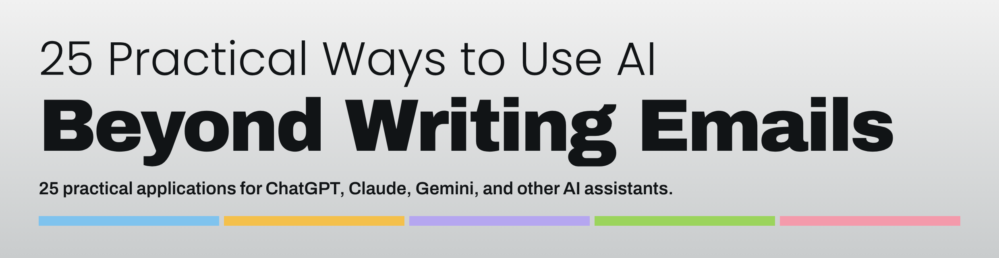

**By Weiwei Hu** · [LinkedIn](https://www.linkedin.com/in/weiweihu)

🔗 [25 Practical Ways to Use AI Beyond Writing Emails](https://wei-wei-hu.github.io/everyday-ai-playbook/)

🤖 Companion: [12 Practical AI Agents](https://wei-wei-hu.github.io/everyday-ai-playbook/agents/), setup guides for everyday AI agents

📄 [Download PDF](25-Practical-Ways-to-Use-AI.pdf) · 🖨️ Print-ready: [Letter](25-Practical-Ways-to-Use-AI-Letter.pdf) | [A4](25-Practical-Ways-to-Use-AI-A4.pdf)

Much of my work involves AI transformation, data and analytics, and improving business processes and workflows. Along the way, I’ve also been exploring how AI can help us in our everyday work and life.

I’ve found AI becomes far more useful when you give it a specific ask, clear context, and something to act on. I put together this playbook with 25 practical applications across work, time, decisions, everyday life, and personal goals.

1. [Break a complicated project into manageable tasks](https://wei-wei-hu.github.io/everyday-ai-playbook/#prompt-1)
2. [Extract important information from long documents](https://wei-wei-hu.github.io/everyday-ai-playbook/#prompt-2)
3. [Prepare for an important meeting](https://wei-wei-hu.github.io/everyday-ai-playbook/#prompt-3)
4. [Practice an important conversation](https://wei-wei-hu.github.io/everyday-ai-playbook/#prompt-4)
5. [Organize scattered notes into useful actions](https://wei-wei-hu.github.io/everyday-ai-playbook/#prompt-5)

6. [Plan your week and adjust when plans change](https://wei-wei-hu.github.io/everyday-ai-playbook/#prompt-6)
7. [Decide what to do first](https://wei-wei-hu.github.io/everyday-ai-playbook/#prompt-7)
8. [Manage recurring responsibilities](https://wei-wei-hu.github.io/everyday-ai-playbook/#prompt-8)
9. [Decide what to hand off](https://wei-wei-hu.github.io/everyday-ai-playbook/#prompt-9)
10. [Create a personal health and wellness plan](https://wei-wei-hu.github.io/everyday-ai-playbook/#prompt-10)

11. [Compare several options side by side](https://wei-wei-hu.github.io/everyday-ai-playbook/#prompt-11)
12. [Find risks you may have overlooked](https://wei-wei-hu.github.io/everyday-ai-playbook/#prompt-12)
13. [Explore what-if scenarios](https://wei-wei-hu.github.io/everyday-ai-playbook/#prompt-13)
14. [Evaluate a business idea](https://wei-wei-hu.github.io/everyday-ai-playbook/#prompt-14)
15. [Solve a problem that keeps coming back](https://wei-wei-hu.github.io/everyday-ai-playbook/#prompt-15)

16. [Understand where your money goes](https://wei-wei-hu.github.io/everyday-ai-playbook/#prompt-16)
17. [Plan meals using what you already have](https://wei-wei-hu.github.io/everyday-ai-playbook/#prompt-17)
18. [Plan a trip around your interests and budget](https://wei-wei-hu.github.io/everyday-ai-playbook/#prompt-18)
19. [Organize home maintenance and responsibilities](https://wei-wei-hu.github.io/everyday-ai-playbook/#prompt-19)
20. [Support children’s learning](https://wei-wei-hu.github.io/everyday-ai-playbook/#prompt-20)

21. [Negotiate a job offer with confidence](https://wei-wei-hu.github.io/everyday-ai-playbook/#prompt-21)
22. [Map your next career move](https://wei-wei-hu.github.io/everyday-ai-playbook/#prompt-22)
23. [Learn a new skill with a structured practice plan](https://wei-wei-hu.github.io/everyday-ai-playbook/#prompt-23)
24. [Turn a personal goal into an action plan](https://wei-wei-hu.github.io/everyday-ai-playbook/#prompt-24)
25. [Review your progress and decide what to do next](https://wei-wei-hu.github.io/everyday-ai-playbook/#prompt-25)

## How to use it

**Start with one thing you already need to do**

1. Pick one task already on your list.
2. Open its card and fill in the [brackets].
3. Paste it into your AI assistant, review the result, and check key facts.

**Put them together**

- **Complete a complex project:** [#1 Project plan](https://wei-wei-hu.github.io/everyday-ai-playbook/#prompt-1) → [#7 Prioritize](https://wei-wei-hu.github.io/everyday-ai-playbook/#prompt-7) → [#9 Delegation plan](https://wei-wei-hu.github.io/everyday-ai-playbook/#prompt-9) → [#25 Weekly review](https://wei-wei-hu.github.io/everyday-ai-playbook/#prompt-25)
- **Make an important decision:** [#11 Side-by-side](https://wei-wei-hu.github.io/everyday-ai-playbook/#prompt-11) → [#12 Risk review](https://wei-wei-hu.github.io/everyday-ai-playbook/#prompt-12) → [#13 Scenarios](https://wei-wei-hu.github.io/everyday-ai-playbook/#prompt-13)
- **Make progress on a personal goal:** [#24 Goal plan](https://wei-wei-hu.github.io/everyday-ai-playbook/#prompt-24) → [#6 Weekly plan](https://wei-wei-hu.github.io/everyday-ai-playbook/#prompt-6) → [#23 Learning plan](https://wei-wei-hu.github.io/everyday-ai-playbook/#prompt-23) → [#25 Weekly review](https://wei-wei-hu.github.io/everyday-ai-playbook/#prompt-25)

## Want more?

Subscribe to my LinkedIn newsletter, **[Afterglimpse](https://www.linkedin.com/newsletters/7433145050123026432/)**, for more practical lessons on using AI at work and in life.

---

© 2026 Weiwei Hu · Licensed under [CC BY-NC-ND 4.0](https://creativecommons.org/licenses/by-nc-nd/4.0/). You may share this with credit; commercial use and modified versions are not permitted.
